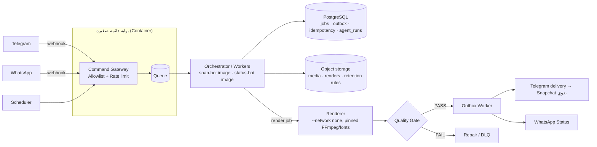

# المراجعة التقنية والمعمارية — snap-status-v3

> النطاق: كل ملفات المستودع حتى الالتزام `eec6f7f`. الملاحظات المذكورة بأنها "مُتحقق منها" أُعيد إنتاجها بتشغيل الكود فعليًا.
> المراجعة تقترح خطة إعادة الهيكلة فقط، ولا تغيّر منطق النواة. الجزء المنفّذ في هذا التغيير هو البنية التحتية للبناء والاختبار والنشر (انظر [CI-CD.md](CI-CD.md)).

## 1. الملخص التنفيذي

المستودع في طور التأسيس: نواة `studio-core` فيها ٧ وحدات صغيرة (Jobs وContent وDelivery وAgents وQuality وSecurity)، وتطبيقان هيكليان، و٤ اختبارات، وتوثيق موسّع. الأساس الفكري جيد (Sacred Lock وOutbox وIdempotency وKill switches). لكن هناك ثلاث مشاكل تمنع التوسع والإنتاج:

1. **بيئة التشغيل المختارة (GitHub Actions كخادم دائم)** لا توفّر الاستمرارية التي تحتاجها Webhooks وجلسة WhatsApp وقاعدة البيانات والـIdempotency.
2. **ضمانات الأمان في النواة تعتمد على الالتزام بالعرف، لا على إنفاذ فعلي**: يمكن تجاوز Sacred Lock، والـIdempotency قابلة للسباق وتضيع بين التشغيلات، والـState Machine تقبل أي انتقال.
3. **التغليف والبنية**: (أُصلحت هنا) التطبيقان كانا يستخدمان نفس اسم الحزمة `app`، فلا يمكن اختبارهما أو نشرهما بشكل مستقل.

## 2. الوضع الحالي

| المكوّن | الحالة قبل هذا التغيير |
| --- | --- |
| `packages/studio-core` | ٧ ملفات ونحو ٢٠٠ سطر، بلا `pyproject` وبلا تغليف |
| `apps/snap-bot`, `apps/status-bot` | دالة `create_job` فقط، وكلاهما في حزمة باسم `app` |
| `config/defaults.toml` | قيم وKill switches لا يقرأها أي كود |
| `tests/` | ٤ اختبارات، وكانت تعتمد على `pythonpath` في pytest |
| CI | Job واحد: compile وpytest على 3.12 فقط، مع فحص أسرار بـ`grep` |
| CD | غير موجود |

## 3. النتائج

مستويات الخطورة: **حرج**: يمنع الإنتاج أو يسبب نشرًا خاطئًا. **عالٍ**: يمنع التوسع أو يكسر ضمانة معلنة. **متوسط** و**منخفض**: جودة وصيانة.

### أ. بيئة التشغيل وقابلية التوسع

**A1 — حرج: GitHub Actions غير مناسب كبيئة تشغيل دائمة للبوتات**

- لا توجد عملية تعمل باستمرار، فلا يمكن استقبال Webhooks من Telegram أو WhatsApp. البديل هو Polling عبر `schedule`، وأقل فاصل له ٥ دقائق، وقد يتأخر أو يُسقط وقت الضغط. وفي المستودعات العامة تُعطَّل الجداول تلقائيًا بعد ٦٠ يومًا بلا نشاط.
- القرص مؤقت: SQLite بوضع WAL والملفات تضيع بعد كل تشغيل. و`actions/cache` ليس قاعدة بيانات: مفاتيحه غير قابلة للتعديل، ويُحذف بعد ٧ أيام بلا استخدام، وحده ١٠GB للمستودع، ولا يدعم الكتابة المتزامنة. فقدان سجل الـIdempotency يعني **نشرًا مكررًا**.
- مجموعات `concurrency` تسمح بتشغيل واحد قيد التنفيذ وتشغيل واحد في الانتظار فقط. أي تشغيل جديد يلغي المنتظر، فتضيع الأوامر الواردة أثناء "وردية" طويلة.
- الحد الأقصى للـJob الواحد ٦ ساعات، والـRunner بمواصفات ثابتة (٤ vCPU / ١٦GB في المستودعات العامة).
- نشر حالة WhatsApp غير الرسمي يحتاج جلسة ومصادقة محفوظة واتصالًا دائمًا، وهذا غير ممكن على Runner مؤقت دون تخزين بيانات الجلسة خارجيًا، وهي بيانات حساسة.
- إنفاذ Egress Proxy وتشغيل Renderer بلا شبكة (من المبادئ غير القابلة للتفاوض) أصعب على Hosted runners.

**التوصية (هجين):** بوابة صغيرة تعمل دائمًا (Webhook + Allowlist + Queue)، مع حالة دائمة في قاعدة بيانات مُدارة وتخزين كائنات للوسائط. ويبقى الـRender الثقيل على Actions (أو على Worker) يُستدعى بـ`workflow_dispatch` أو `repository_dispatch`. الصور التي يبنيها خط النشر الجديد تعمل في البيئتين دون تعديل. انظر القسم 4.

**A2 — عالٍ: لا توجد طبقة بيانات**

كل الحالة في الذاكرة (`IdempotencyRegistry._completed: set`). المخطط ينص على SQLite ثم PostgreSQL عبر Repository، ولا توجد واجهة Repository ولا Migrations.

### ب. البنية والتغليف

**B1 — عالٍ (أُصلح): تعارض اسم الحزمة `app`** — مُتحقق منه.
كان المساران `apps/snap-bot` و`apps/status-bot` معًا في `pythonpath`، وكلاهما يحتوي `app/main.py`. لذلك كان `import app.main` يحمّل snap-bot دائمًا، وstatus-bot غير قابل للاختبار. الحل: أُعيدت تسميتهما إلى `snap_bot` و`status_bot`، وأُضيف اختبار معماري يمنع تكرار ذلك.

**B2 — عالٍ (أُصلح): لا تغليف مستقل**
مبدأ "الاستقلال يتحقق بالنشر" يتطلب أن يُبنى كل تطبيق وحده. الحل: uv workspace بثلاث حزم (`studio-core` و`snap-bot` و`status-bot`)، وملف `uv.lock` يثبّت الإصدارات، وصورة Docker لكل تطبيق، وCI يبني فقط التطبيقات المتأثرة بالتغيير.

**B3 — متوسط: حدود النواة غير محمية**
لم يكن هناك ما يمنع التطبيق من استيراد التطبيق الآخر، أو النواة من استيراد تطبيق. أُضيف `tests/test_architecture.py` لإنفاذ هذه الحدود. يبقى المطلوب: Contract tests لكل واجهة عامة في النواة، وتقسيم النواة إلى حزم فرعية (`jobs/` و`delivery/` و`religious/`…) عندما تكبر.

**B4 — متوسط (جزئيًا): الإعدادات غير موصولة**
أُضيف `studio_core.config` (قراءة TOML مع رفض القيم الناقصة) وربط Kill switch كل تطبيق بالـCLI. يبقى المطلوب: Schema مكتوبة الأنواع ترفض المفاتيح المجهولة، وإمكانية Overrides لكل تطبيق ولكل بيئة.

### ج. صحة الكود والأنماط غير الآمنة

**C1 — حرج: Idempotency غير ذرّية وغير دائمة**
`already_delivered()` ثم `mark_delivered()` خطوتان منفصلتان (check-then-act). إذا تزامن عاملان أو أعيدت محاولة بعد انقطاع، يحدث نشر مكرر. والسجل يضيع عند إعادة التشغيل.
التوصية: Outbox دائم بقيد `UNIQUE(idempotency_key)`، وحجز ذرّي (`INSERT … ON CONFLICT DO NOTHING` ثم الانتقال إلى `PUBLISHING` مع Lease ومهلة)، ثم `PUBLISHED`. ويُضاف Namespace للمفتاح (تاريخ أو حملة) إذا كان تكرار المحتوى نفسه مقصودًا.

**C2 — عالٍ: `Job.transition` لا تطبّق State Machine**
يمكن الانتقال من `COMPLETED` إلى `RUNNING`، و`attempts` لا تزيد، ولا يوجد سجل زمني للانتقالات (Job Timeline مطلوب في المخطط).
التوصية: جدول انتقالات مسموحة، وحالات نهائية مقفلة، وسجل أحداث لكل انتقال. ونفس المعالجة لـ`OutboxState`.

**C3 — عالٍ: يمكن تجاوز Sacred Lock**
- `ContentPackage` كائن dataclass قابل للتعديل، فالسطر `item.body = "…"` يتجاوز `replace_body` والقفل.
- العنوان `title` والبيانات الوصفية `metadata` خارج القفل.
- لا توجد سياسة تطبيع Unicode صريحة: النص العربي نفسه بترميزين مختلفين للتشكيل يعطي Hash مختلفًا.

التوصية: كائن قيمة غير قابل للتعديل (`LockedText`) ينتج عن التحقق، مع منع `__setattr__` بعد القفل، وتوثيق سياسة الترميز والتطبيع المعتمدة للمصدر المرجعي واختبارها.

**C4 — متوسط: Hash الوكلاء غير ثابت وأخطاؤهم غير منقّحة** — مُتحقق منه.
`_hash(repr(value))` يعطي قيمًا مختلفة لنفس المدخلات بين تشغيلين (مثال: مجموعة نصوص مع `PYTHONHASHSEED` مختلف، أو كائنات تتضمن عنوان الذاكرة في `repr`)، وهذا يُفشل مقارنات Golden. كما يُحفظ `str(exc)` في `AgentRun` دون تمريره على `redact_secrets`.
التوصية: تسلسل قانوني (JSON مرتّب المفاتيح، مع ترتيب المجموعات) قبل حساب الـHash، وتنقيح الأخطاء، وإضافة `job_id` و`started_at`.

**C5 — متوسط: `redact_secrets` لا يغطي صيغًا شائعة** — مُتحقق منه.
القيم التالية تمر دون تنقيح: `{"token": "…"}` (JSON)، و`Authorization: Bearer …`، و`?key=…` في الروابط.

**C6 — منخفض:** كائن `Delivery` بلا `expires_at`، مع أن المخطط يمنع نشر المحتوى منتهي الصلاحية. و`QualityReport` بلا عتبات رقمية.

### د. التوثيق والحوكمة

**D1 — متوسط: تناقضات بين المراجع**
`ARCHITECTURE_V3_AGREED.md` يفترض VPS، ويجعل Telegram قناة احتياطية لـStatus، ويرقّم المراحل 0–12. أما `README` و`DECISIONS.md` فيعتمدان Actions وWhatsApp فقط ومراحل 0–7. ويوجد ملفان شبه متطابقين (~25KB) للمخطط.
التوصية: مرجع واحد مُحدَّث، والقرارات اللاحقة على شكل ADRs مرقّمة في `docs/adr/`.

**D2 — متوسط: تعدد المستودعات**
`snap-bot` و`snap-bot-v2` و`status-bot` و`status-bot-v2` و`snap-status-v3` مستودعات متداخلة. يجب تحديد مصدر الحقيقة لكل قدرة (المرجع القديم للقراءة، وV3 للتطوير)، وأرشفة ما يُستبدل بعد Shadow Mode.

### هـ. CI/CD قبل هذا التغيير

- لا Lint ولا Type check، والاختبار على 3.12 فقط مع أن `requires-python >= 3.11`.
- فحص الأسرار بـ`grep` على أسماء محددة فقط.
- لا بناء ولا صور ولا بيئات ولا Rollback، والمخطط (القسم 17) يتطلب "Rollback موثّق لكل Deployment".

كل هذا أُعيد بناؤه، والتفاصيل في [CI-CD.md](CI-CD.md).

## 4. المعمارية المستهدفة

- **الفصل لكل تطبيق:** قاعدة بيانات أو Schema مستقلة، وBucket مستقل، وSecrets على مستوى GitHub Environment لكل تطبيق (`snap-bot-production` و`status-bot-production`).
- **مكان التشغيل:** البوابة والعمال في حاوية واحدة صغيرة لكل تطبيق (VPS أو Fly.io أو Cloud Run). ويمكن إبقاء الـRender على Actions عبر `workflow_dispatch` إذا أردت تقليل التكلفة. صور GHCR الحالية تعمل في الحالتين.
- **الطابور:** يبدأ بجدول في PostgreSQL (`SELECT … FOR UPDATE SKIP LOCKED`) دون إضافة Broker، تطبيقًا لمبدأ "الطبقات المتقدمة عند ثبوت الحاجة".

## 5. خطة إعادة الهيكلة المرحلية

| # | العمل | معيار الخروج | ربطها بالمراحل |
| --- | --- | --- | --- |
| R0 ✅ | Workspace بثلاث حزم، وCI/CD، وقراءة الإعدادات، واختبارات الحدود، وpre-commit | CI أخضر، وصور قابلة للنشر والرجوع | 1 |
| R1 | **ADR لبيئة التشغيل** (هجين أو VPS أو Actions مع تخزين خارجي) | قرار المالك موثّقًا | 0 |
| R2 | طبقة Repository مع Migrations: SQLite محليًا وPostgreSQL للإنتاج، وجداول jobs وdeliveries وidempotency وagent_runs | Job تجريبي يمر بكل الحالات ويُستأنف بعد إعادة التشغيل | 1 |
| R3 | State Machine حقيقية للـJob والـOutbox، وسجل انتقالات | اختبارات الانتقالات الممنوعة والحالات النهائية | 1 |
| R4 | Outbox ذرّي مع Lease وانتهاء صلاحية | اختبار محاكاة إعادة المحاولة والتزامن: صفر نشر مكرر | 1 و5 |
| R5 | `LockedText` غير قابل للتعديل، وسياسة Unicode، وتغطية العنوان | اختبارات Religious Integrity في CI | 4 |
| R6 | Hash قانوني للوكلاء، وتنقيح الأخطاء، وتوسيع `redact_secrets` | Golden tests ثابتة عبر تشغيلات متعددة | 3 |
| R7 | Contract tests للنواة، وحزم فرعية، وإصدار النواة مع Canary على Snap | تغيير في النواة يشغّل اختبارات التطبيقين | 3 |
| R8 | Pipeline ثقيل ليلي: صورة Render مثبّتة (FFmpeg + خطوط)، وGolden screenshots، وE2E مع Mocks | Workflow ليلي أخضر | 4 |
| R9 | Observability: سجلات JSON منظمة، ومقاييس p50/p95، وتنبيهات | لوحة مؤشرات النجاح في المخطط | 6 |

## 6. قرارات مطلوبة من المالك

1. بيئة التشغيل: هجين (موصى به)، أو VPS، أو الإبقاء على Actions مع تخزين خارجي للحالة.
2. قاعدة البيانات المُدارة ومزود تخزين الكائنات.
3. هل يُسمح بتكرار نشر نفس المحتوى (مثل آية متكررة)؟ هذا يحدد Namespace مفتاح الـIdempotency.
4. سياسة تطبيع النص الديني: مقارنة حرفية للبايتات، أم NFC، أم غيرها.
