# خط التكامل والنشر المستمر (CI/CD)

## نظرة عامة

```mermaid
flowchart LR
  PR[Pull request] --> CI
  subgraph CI["CI (ci.yml)"]
    CH[changes] --> B
    L[lint: ruff · format · mypy] --> B[build image + offline smoke<br/>للتطبيقات المتأثرة فقط]
    T[tests 3.11/3.12 + coverage ≥ 80%] --> B
    S[gitleaks]
    W[actionlint + shellcheck]
  end
  CI --> OK[CI passed]
  MAIN[push main] --> CD
  TAG[tag app-vX.Y.Z] --> CD
  subgraph CD["CD (cd.yml)"]
    G[CI gate] --> P[plan] --> PUB[publish → GHCR] --> STG[staging + smoke] --> PRD[production<br/>موافقة يدوية + Release]
  end
```



| Workflow | المشغّل | الوظيفة |
| --- | --- | --- |
| `ci.yml` | كل PR، يدويًا، أو يُستدعى من CD | Lint وType check واختبارات على 3.11/3.12 وفحص أسرار وفحص Workflows، وبناء صورة كل تطبيق متأثر واختبارها دون شبكة. الـJob `CI passed` هو الفحص المطلوب للدمج |
| `cd.yml` | يدويًا فقط حاليًا (الدفع وTags معطلان حتى التخرّج؛ انظر `GRADUATION.md`) | يعيد تشغيل CI كبوابة، ثم ينشر صور التطبيقات المتأثرة إلى GHCR، ثم Staging تلقائيًا، ثم Production عند Tag أو بالاختيار اليدوي |
| `rollback.yml` | يدويًا | يعيد بيئة تطبيق إلى Tag محدد أو إلى `<env>-previous` |
| `run-snap-bot.yml` / `run-status-bot.yml` | يدويًا | يشغّل أمرًا من صورة `:production` لكل بوت، بشكل مستقل. بلا `schedule` لأن Kill switch المجدول ما زال `false` |

## الصور والبيئات

- الصور: `ghcr.io/khalidshar/snap-bot` و`ghcr.io/khalidshar/status-bot`.
- Tags ثابتة لكل التزام: `sha-<12 حرفًا>`، ولكل إصدار: `X.Y.Z`.
- Tags متحركة لكل بيئة: `:staging` و`:production`، والنسخة السابقة تُحفظ تلقائيًا في `:<env>-previous`.
- النشر يعني نقل Tag البيئة إلى صورة سبق بناؤها واختبارها (`docker buildx imagetools create`)، دون إعادة بناء. لذلك يكون الـRollback فوريًا وقابلًا للتدقيق.
- البيئات منفصلة لكل تطبيق: `snap-bot-staging` و`snap-bot-production` و`status-bot-staging` و`status-bot-production`، ولكل بيئة Secrets خاصة.

## إعداد لمرة واحدة في GitHub

1. **Settings → Environments:** أنشئ البيئات الأربع. وفي بيئتي `*-production` فعّل *Required reviewers*، وقيّد *Deployment branches and tags* بـ`main` والـTags بصيغة `*-v*`.
2. **Settings → Branches → main:** فعّل Require status checks، واختر `CI passed`.
3. **Settings → Tags (Rulesets):** احمِ النمط `*-v*` حتى لا ينشئ Tags الإنتاج إلا المالك.
4. بعد أول نشر، ستظهر الحزمتان في GHCR مربوطتين بالمستودع. اترك وصول Actions مفعّلًا.
5. أضف Secrets كل بوت (مثل `TG_TOKEN` و`TG_CHAT` لـSnap) في بيئته فقط، لا على مستوى المستودع.

## سير الإصدار

```bash
# 1) (معطل حتى التخرّج) PR → CI → دمج إلى main → نشر تلقائي إلى staging للتطبيقات المتأثرة
# 2) إصدار تطبيق واحد إلى الإنتاج:
git tag snap-bot-v0.1.0 && git push origin snap-bot-v0.1.0
#    → CI → publish → staging → (موافقة) production → GitHub Release
```

## الرجوع (Rollback)

- من GitHub: **Actions → Rollback → Run workflow**، ثم اختر التطبيق والبيئة. اترك الـTag فارغًا للرجوع إلى النسخة السابقة.
- من الطرفية (بعد `docker login ghcr.io`):
  `make rollback APP=snap-bot ENV=production` أو `make rollback APP=snap-bot ENV=production TAG=sha-0123456789ab`.

## السكربتات المحلية

| الأمر | السكربت | الوظيفة |
| --- | --- | --- |
| `make bootstrap` | `scripts/bootstrap.sh` | تثبيت بيئة التطوير المقفلة (uv) وpre-commit |
| `make lint` | `scripts/lint.sh` | ruff وفحص التنسيق وmypy strict وshellcheck وactionlint |
| `make test` | `scripts/test.sh all` | الاختبارات مع بوابة التغطية وتقارير `reports/`. وتوجد أهداف جزئية: `core` و`snap-bot` و`status-bot` |
| `make build` / `make images` | `scripts/build.sh` | بناء Wheels، ثم صورة لكل تطبيق |
| `make smoke APP=…` | `scripts/smoke.sh` | تشغيل `healthcheck` و`dry-run` داخل الحاوية دون شبكة وبنظام ملفات للقراءة فقط |
| `make secrets` | `scripts/secret-scan.sh` | gitleaks مع قواعد المشروع في `.gitleaks.toml` |
| `make ci` | — | يشغّل CI كاملًا محليًا |
| `make deploy APP=… ENV=… TAG=…` | `scripts/deploy.sh` | ترقية صورة إلى بيئة مع Smoke test |
| — | `scripts/changed-apps.sh` و`scripts/release-plan.sh` | منطق اختيار التطبيقات المتأثرة وخطة الإصدار، ويستخدمهما CI وCD |

تتطلب السكربتات `uv` وDocker (مع buildx). إذا واجهت حد طلبات Docker Hub محليًا، استخدم صورة أساس بديلة:
`DOCKER_BUILD_FLAGS="--build-arg BASE_IMAGE=mirror.gcr.io/library/python:3.12-slim" make images`.

## التشغيل على السيرفر

تشغيل Snap على السيرفر يتم يدويًا من إصدار ثابت لكل التزام، بدون Actions. التفاصيل في `SERVER-RUNTIME.md`. تثبّته وظيفة CI «Snap release install»: تثبيت حقيقي، ثم انتقال، ثم رجوع، على Runner مؤقت.

## نقاط تمديد مخطط لها

- Workflow ليلي للاختبارات الثقيلة (Render حقيقي، Golden screenshots، E2E بـMocks) عند إضافة الـRenderer.
- إضافة FFmpeg والخطوط إلى `docker/Dockerfile` بإصدارات مثبّتة عند بدء المرحلة 2.
- عند حسم بيئة التشغيل (انظر [ARCHITECTURE-REVIEW.md](ARCHITECTURE-REVIEW.md))، تُضاف خطوة `deploy` لهدف التشغيل الفعلي بعد نقل الـTag، ويبقى باقي الخط كما هو.
